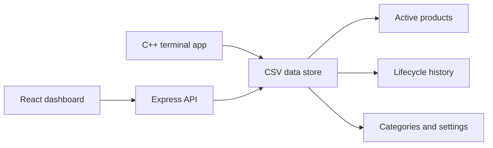

# Expiry Bud

<p align="center">
  <strong>A private, local-first household expiry tracker.</strong><br>
  Track products, receive expiry alerts, record outcomes, and understand household waste from a web dashboard or terminal.
</p>

<p align="center">
  
  
  
  
</p>

## What Expiry Bud does

Expiry Bud keeps household expiry information on your computer. The C++ terminal application and React dashboard use the same CSV data files, so you can choose the interface that suits you.

- Add, edit, search, filter, and delete products
- Classify products as **Safe**, **Expiring**, or **Expired** automatically
- Configure how many days before expiry an alert should appear
- Record products as **Consumed**, **Discarded**, or **ExpiredUnused**
- Move overdue products into history automatically
- Review waste rate, estimated financial loss, category trends, and monthly trends
- Create and remove household product categories
- Preserve data in human-readable CSV files with atomic updates
- Run locally without an account, cloud database, or external service

## How it works



Both interfaces read and write the same `data/` directory. Run only one interface while editing data to avoid simultaneous writes.

## Prerequisites

Install the tools needed for the interface you plan to use.

| Tool | Required for | Supported version |
| --- | --- | --- |
| Node.js | Web dashboard | `20.19+` or `22.12+` |
| npm | Web dashboard | Included with Node.js |
| C++ compiler | Terminal application | C++17 compatible |
| Make | Simple terminal build | GNU Make or compatible |
| CMake | Alternative terminal build | `3.16+` |

Check your installation:

```bash
node --version
npm --version
c++ --version
make --version
```

## Quick start: web dashboard

### 1. Clone the repository

```bash
git clone https://github.com/suryakathyakeyaboddi-creator/Expiry_Bud.git
cd Expiry_Bud
```

### 2. Install dashboard packages

```bash
npm install
```

### 3. Start the development dashboard

```bash
npm run dev
```

Open [http://localhost:4173](http://localhost:4173). The command starts both services:

- Vite web interface on `http://localhost:4173`
- Express API on `http://127.0.0.1:4174`

### 4. Add your first product

1. Select **Add product**.
2. Enter the product name, category, expiry date, quantity, and unit.
3. Optionally enter the manufacture date and unit price.
4. Select **Add product** to save it.
5. Use **Consumed** or **Discard** when the product leaves your active inventory.

Dates use `DD-MM-YYYY`, for example `31-12-2027`.

## Production dashboard

Build the optimized frontend and serve it through Express:

```bash
npm run build
npm start
```

Open [http://127.0.0.1:4174](http://127.0.0.1:4174).

## Quick start: terminal application

### Build with Make

```bash
make
./bin/expirybud
```

The numbered menu provides product management, search, sorting, lifecycle outcomes, analytics, categories, and settings. Enter the number shown beside an option and follow the prompts.

### Build with CMake

```bash
cmake -S . -B build
cmake --build build
./build/expirybud
```

### Use a separate data directory

Pass an absolute directory to the terminal application:

```bash
./bin/expirybud /absolute/path/to/my-expiry-data
```

For the dashboard, set `EXPIRYBUD_DATA_DIR` before starting it:

```bash
EXPIRYBUD_DATA_DIR=/absolute/path/to/my-expiry-data npm start
```

## Dashboard sections

| Section | Purpose |
| --- | --- |
| Overview | Current totals, near-expiry alerts, and household waste rate |
| Products | Add, search, filter, edit, consume, discard, or delete active products |
| History | Review completed product lifecycles and recorded value |
| Analytics | Compare waste counts and estimated loss by category and month |
| Settings | Change the alert window and manage product categories |

## Expiry status rules

Expiry Bud calculates status each time it loads the data.

| Days remaining | Status |
| --- | --- |
| Less than `0` | Expired |
| `0` through the configured threshold | Expiring |
| Greater than the configured threshold | Safe |

A product expiring today remains **Expiring** until the date has passed. The default alert threshold is seven days and can be changed from **Settings**.

## Data and privacy

Expiry Bud creates these files automatically inside `data/`:

| File | Contents |
| --- | --- |
| `products.csv` | Active products and their expiry information |
| `history.csv` | Consumed, discarded, and expired lifecycle records |
| `categories.csv` | Default and custom categories |
| `settings.txt` | Alert threshold |

These files are excluded from Git so household records are not published accidentally. Back up the `data/` directory if the records matter to you. Financial analytics exclude records without a unit price.

## Commands

### Dashboard commands

| Command | What it does |
| --- | --- |
| `npm install` | Installs dashboard dependencies |
| `npm run dev` | Runs Vite and Express in development mode |
| `npm run dev:client` | Runs only the Vite frontend |
| `npm run dev:server` | Runs only the Express API |
| `npm run build` | Creates an optimized frontend in `dist/` |
| `npm start` | Serves the API and built frontend on port `4174` |
| `npm test` | Runs all dashboard API and UI tests |
| `npm run test:api` | Runs API tests only |
| `npm run test:ui` | Runs React UI tests only |

### C++ commands

| Command | What it does |
| --- | --- |
| `make` | Builds the terminal application |
| `make test` | Builds and runs the C++ test suite |
| `make test-all` | Runs the C++ and dashboard test suites |
| `make dashboard-build` | Builds the production dashboard |
| `make dashboard-start` | Builds and starts the production dashboard |
| `make clean` | Removes compiled C++ binaries and `dist/` |

## Testing

Install npm packages before running the complete suite:

```bash
npm install
make test-all
```

The tests cover date calculations, expiry boundaries, validation, persistent IDs, searching, sorting, lifecycle transitions, analytics, CSV round trips, corruption reporting, API validation and side effects, dashboard navigation, and product forms.

## Project structure

```text
Expiry_Bud/
├── dashboard/
│   ├── client/          React and Bootstrap dashboard
│   └── server/          Express API and CSV adapter
├── data/                Local runtime data, excluded from Git
├── docs/                Requirements, architecture, and test documentation
├── include/expirybud/   C++ public headers
├── src/                 C++ implementation and terminal entry point
├── tests/
│   ├── api/             Express API tests
│   ├── ui/              React component tests
│   └── test_main.cpp    C++ test suite
├── CMakeLists.txt       Portable CMake build
├── Makefile             Common build and test commands
└── package.json         Dashboard dependencies and scripts
```

## REST API

The local Express server provides:

| Method and path | Purpose |
| --- | --- |
| `GET /api/dashboard` | Overview snapshot, alerts, counts, and analytics |
| `GET /api/products` | Search and filter active products |
| `POST /api/products` | Create a product |
| `PUT /api/products/:id` | Update a product |
| `DELETE /api/products/:id` | Delete a product |
| `POST /api/products/:id/outcome` | Move a product to history |
| `GET /api/history` | Read lifecycle history |
| `GET /api/analytics` | Read waste analytics |
| `GET /api/categories` | Read categories |
| `POST /api/categories` | Add a category |
| `DELETE /api/categories/:name` | Remove an unused category |
| `GET /api/settings` | Read settings |
| `PUT /api/settings` | Update the alert threshold |

## Troubleshooting

### The dashboard opens but data does not load

Confirm the Express service is running. `npm run dev` should show both `api` and `ui` processes. If only Vite is running, start the API with `npm run dev:server`.

### Port 4173 or 4174 is already in use

Stop the process using the port, then run `npm run dev` again. The production server also accepts a custom `PORT`:

```bash
PORT=5000 npm start
```

### The C++ build cannot find a compiler

Install a C++ compiler and Make. On macOS, install Xcode Command Line Tools. On Ubuntu or Debian, install the `build-essential` package. Windows users can build with CMake and a C++17-capable Visual Studio toolchain.

### A CSV error mentions a line number

Close Expiry Bud, back up `data/`, and inspect the reported CSV line. Values containing commas or quotes must follow standard CSV quoting rules.

## Documentation

Additional project documentation is available in [`docs/`](docs/):

- [`requirements.md`](docs/requirements.md)
- [`architecture.md`](docs/architecture.md)
- [`test-cases.md`](docs/test-cases.md)
- [`implementation-status.md`](docs/implementation-status.md)
